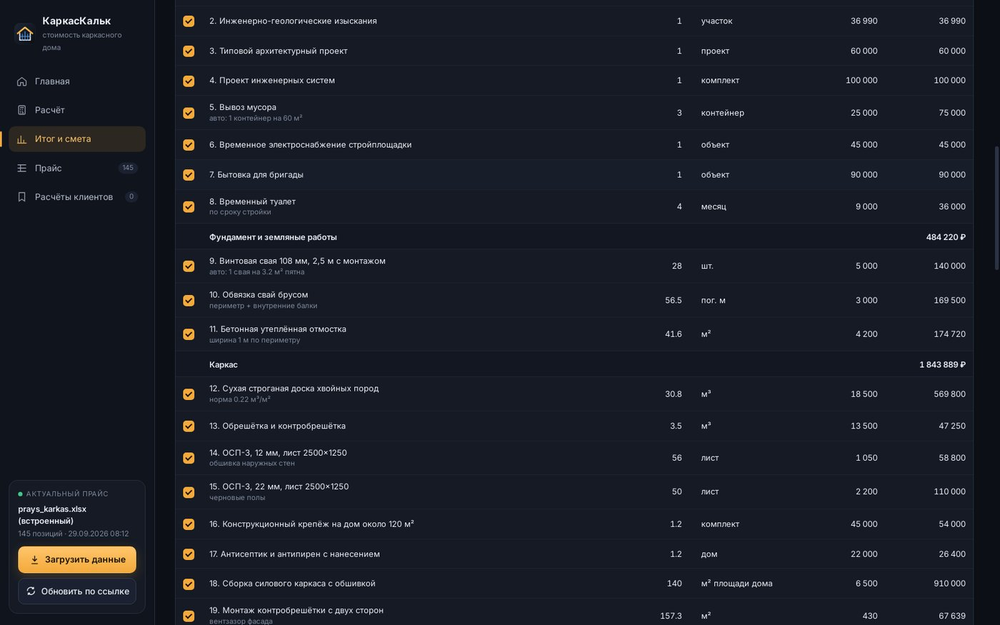
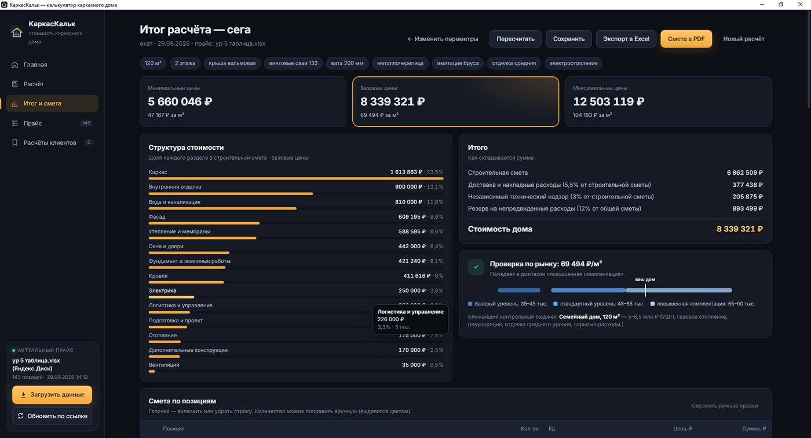

# КаркасКальк

Настольное приложение для Windows: смета каркасного дома за 5 минут по прайсу строительной компании.

## Скачать

**[Скачать для Windows (KarkasCalc-Setup-1.0.0.exe, 81 МБ)](https://github.com/permykov291281-sys/karkas-kalk/releases/latest)**

Windows 10/11, 64 бит, права администратора не нужны. Установщик не подписан сертификатом, поэтому Windows может показать «Система Windows защитила ваш компьютер». Нажмите «Подробнее», затем «Выполнить в любом случае».

## Для кого и какую задачу решает

Для менеджеров и прорабов компаний, которые строят каркасные дома. Обычно смету собирают вручную в Excel: менеджер долго подбирает позиции и пересчитывает объёмы, а клиент ждёт ответа днями. В КаркасКальк менеджер вводит пожелания клиента: площадь, фундамент, утепление, кровлю, фасад, отделку и инженерию. Программа сама считает объёмы материалов и стоимость по каждому разделу, а цены берёт из прайса самой компании. Смету можно отдать клиенту прямо на встрече.

## Что умеет

- **Расчёт в 8 шагов:** объект, участок, фундамент, каркас, кровля и фасад, отделка, инженерия, логистика. Итог пересчитывается сразу после каждого изменения.
- **Три уровня цены:** минимальная, базовая и максимальная стоимость дома и цена за м².
- **Структура стоимости:** доли разделов, накладные расходы, технадзор и резерв на непредвиденные расходы.
- **Проверка по рынку:** показывает, в какой диапазон рыночных цен попадает дом, и сравнивает его с контрольными бюджетами из прайса.
- **Смета по позициям:** строку можно отключить галочкой, а количество поправить вручную. Ручные правки выделяются цветом.
- **Свой прайс в Excel:** 145 позиций в 16 разделах. Позиции ищутся по названию, поэтому строки можно переставлять и добавлять новые. Нормы расхода лежат в отдельном листе.
- **Обновление прайса по ссылке** с Яндекс.Диска или из Google Таблиц. Ссылка запоминается, дальше достаточно одной кнопки.
- **Экспорт** сметы в Excel и PDF.
- **Расчёты клиентов:** расчёт сохраняется в карточку клиента, его можно открыть позже и пересчитать по новому прайсу.

## Стек

- **Electron 33**: настольное приложение. Логика расчёта и интерфейс написаны на чистом JavaScript, HTML и CSS, без фреймворков.
- **SheetJS (xlsx)**: чтение прайса и экспорт сметы в Excel.
- **electron-builder и NSIS**: установщик для Windows. Он собирается своим NSIS-скриптом, поэтому собрать его можно и на Linux, без Wine.

Основные файлы:

| Файл | Что внутри |
|---|---|
| `src/engine.js` | ядро расчёта: объёмы, нормы, поиск позиций в прайсе |
| `src/app.js`, `src/index.html`, `src/styles.css` | интерфейс |
| `main.js`, `preload.js` | main-процесс: загрузка прайса из файла и по ссылке, экспорт, сохранённые расчёты |
| `data/prays_karkas.xlsx` | встроенный прайс (145 позиций) |
| `build/` | иконка, NSIS-скрипт установщика, хук `afterPack` |

## Скриншоты

**Главная**


**Расчёт: шаг «Фундамент»**


**Итог расчёта**


**Смета по позициям**


**Прайс**


**Запуск на Windows**


## Запуск из исходников и сборка

Нужен Node.js 18 или новее.

```bash
git clone https://github.com/permykov291281-sys/karkas-kalk.git
cd karkas-kalk
npm install          # около 3 минут, скачивается Electron
npm start            # запуск приложения
```

Сборка установщика для Windows:

```bash
npm run dist:win     # результат: dist/KarkasCalc-Setup-1.0.0.exe
```

Скрипт сначала собирает `dist/win-unpacked` через electron-builder, затем запускает `build/make-installer.js`. Тот вызывает `makensis` из кэша electron-builder или системный и упаковывает установщик по `build/installer.nsi`. Иконка вшивается в exe в `build/afterPack.js` через resedit.

Свой прайс: в приложении нажмите «Прайс», затем «Скачать шаблон». Поменяйте цены в колонках «Минимальная / Базовая / Максимальная цена» и загрузите файл кнопкой «Загрузить данные». Названия позиций не меняйте: по ним калькулятор находит строки. Данные программы (прайс, расчёты) хранятся в `%APPDATA%\karkas-calc`.

Нормы расхода (доска 0,22 м³ на м², одна свая на 3,2 м² и т. п.) оценочные. Для реального заказа их стоит сверить с прорабом.

---

Разработка — вайб-кодинг в Claude Code.
